# SportHost — audit trải nghiệm người chơi và host, 31/10/2026

**Kết luận:** các luồng chính hoàn thành được, nhưng còn **4 vấn đề P1**, **7 vấn đề P2** và **1 nhóm P3**. Cần ưu tiên tính nhất quán của thông tin nhận tiền và khả năng theo dõi đăng ký trước khi mở rộng beta.

Đây là audit qua giao diện trên **https://sporthost.vercel.app**, không phải chỉ đọc source hoặc chạy lại bộ unit test. Không sửa hoặc deploy code sản phẩm trong đợt này.

## Cách kiểm tra

- Áp dụng skill **UI UX Pro Max**, đặc biệt các quy tắc web về phản hồi thao tác, lỗi tại trường nhập, trạng thái, điều hướng và responsive. Hai truy vấn đã đối chiếu kết quả phù hợp: `error summary validation` và `mobile table actions`, domain `ux`.
- Edge qua Playwright; viewport **1440×1000**, **375×812**, **768×1024**, **812×375**; có kiểm tra bàn phím menu và reduced motion. Đây là mô phỏng viewport, chưa phải chạy trên iPhone/Android vật lý.
- Một tài khoản host mới, một CLB thử, một member cố định và hai khách vãng lai. Đăng ký, nhập sai dữ liệu, duyệt booking, gửi/duyệt biên nhận, tạo lịch tuần, RSVP, hủy tham gia và tạo phí tháng đều thao tác bằng giao diện.
- Ảnh tài khoản A/B chỉ là fixture ghi rõ **TEST ONLY**, không phải QR ngân hàng thật. Không chuyển tiền, gửi email hay thông báo cho người khác.
- Axe kiểm tra sáu màn hình: thành viên, buổi đánh, CLB, thu chi, biên nhận và đăng nhập. Kết quả tự động không thay thế kiểm thử screen reader thủ công.
- Dữ liệu và ảnh test được dọn theo đúng tài khoản/CLB đã tạo; thông tin đăng nhập và cookie nằm ngoài Git.

## Các việc đã làm được

| Vai trò | Nhiệm vụ | Kết quả |
| --- | --- | --- |
| Host mới | Đăng ký, tạo CLB, tạo buổi đầu tiên | Hoàn thành qua giao diện; trạng thái trống có lời hướng dẫn |
| Host | Đăng xuất, đăng nhập đúng/sai mật khẩu | Đăng nhập đúng thành công; lỗi sai mật khẩu hiển thị được |
| Host | Tạo hồ sơ nữ cố định | Hoàn thành; loại thành viên và giới tính độc lập |
| Khách | Nhập số sai, số mới, kiểm tra hồ sơ rồi gửi yêu cầu | Hoàn thành; chưa xác nhận thì chưa tạo booking |
| Host và khách | Duyệt chỗ, upload biên nhận, đối chiếu đã thu | Hoàn thành; upload không tự đánh dấu đã thu |
| Member cố định | Mở link RSVP, xác nhận tham gia, hủy với xác nhận | Hoàn thành; trạng thái được lưu |
| Host | Tạo lịch hai tuần và phí tháng | Hoàn thành về dữ liệu; còn lỗi phản hồi/điều hướng bên dưới |
| Mobile | Menu, Escape, nội dung cơ bản và trường số điện thoại | Không tràn ngang toàn trang ở các viewport đã thử; focus menu nằm trong sidebar; input và body mobile 16px |

## Danh sách ưu tiên

P1: nên sửa trước khi mở rộng beta. P2: gây chậm, nhầm lẫn hoặc khó tiếp cận. P3: hoàn thiện nội dung.

| ID | Mức | Vấn đề đã tái hiện | Hướng sửa |
| --- | --- | --- | --- |
| UX-01 | **P1** | Booking giữ QR A nhưng sau khi host cập nhật, lại hiện tên ngân hàng/số tài khoản B | Lưu và hiển thị cùng một phiên bản thông tin nhận tiền |
| UX-02 | **P1** | Khách đổi trình duyệt không lấy lại được trang đăng ký riêng dù nhập đúng số điện thoại | Có cách lưu và khôi phục link an toàn; kênh liên hệ host rõ ràng |
| UX-03 | **P1** | Host đã duyệt nhưng trang khách đang mở vẫn ghi “Chờ host duyệt” | Nút cập nhật trạng thái, đồng bộ định kỳ và trạng thái cập nhật rõ ràng |
| UX-04 | **P1** | “Quên mật khẩu” nhận email rồi mới báo dịch vụ chưa sẵn sàng | Bật dịch vụ email; trong lúc chờ phải báo trước và có cách hỗ trợ thực tế |
| UX-05 | P2 | Nhập sai số điện thoại host bị đưa sang trang 400 “Invalid phone”; đăng nhập sai làm trống email | Giữ form/ngữ cảnh, báo lỗi tiếng Việt tại trường nhập, giữ dữ liệu phù hợp |
| UX-06 | P2 | Bảng người chơi mobile che nút thao tác; kéo tới nút thì mất tên người chơi | Card trên mobile hoặc giữ tên cố định với thao tác chính dễ chạm |
| UX-07 | P2 | Tạo phí tháng xong về Tổng quan, không có thông báo thành công | Giữ tab Phí tháng và chỉ rõ khoản vừa tạo/cập nhật |
| UX-08 | P2 | Host thấy “Mở đăng ký” trong khi link khách còn khóa để ưu tiên RSVP | Dùng cùng quy tắc trạng thái và ghi rõ giờ mở khách |
| UX-09 | P2 | Link RSVP riêng chỉ mở tab mới; không có Copy/Chia sẻ tại từng member | Thêm Copy/Chia sẻ đúng link riêng và phản hồi đã sao chép |
| UX-10 | P2 | Nút Lưu vẫn hoạt động, giữ nguyên chữ khi request đang chờ | Thể hiện “Đang lưu…”, hạn chế gửi lặp và phản hồi thành công/lỗi |
| UX-11 | P2 | ARIA tab sai; link nội dòng chỉ phân biệt bằng màu; vài đích chạm 32px | Hoàn thiện ngữ nghĩa tab/link, kiểu hiển thị link và vùng chạm |
| UX-12 | P3 | Chữ “SPORTSHOST”, ngày/giờ UTC kỹ thuật và thuật ngữ pha trộn | Chuẩn hóa thương hiệu, từ ngữ và thời gian theo người dùng Việt Nam |

## Bằng chứng và cách tái hiện

### UX-01 — QR và thông tin nhận tiền không cùng phiên bản

1. Host lưu ảnh tài khoản A cùng thông tin ngân hàng A.
2. Khách đăng ký và được xác nhận chỗ; trang thanh toán hiển thị ảnh A.
3. Host đổi ảnh và toàn bộ thông tin nhận tiền sang B.
4. Khách tải lại trang: ảnh vẫn ghi **ACCOUNT A**, nhưng phần tên ngân hàng, chủ tài khoản và số tài khoản chuyển sang **B**.

Đã đối chiếu nội dung ảnh trước/sau bằng SHA-256: ảnh của booking không đổi, trong khi text đổi. Đây là mâu thuẫn có thể dẫn tới chuyển tiền sai người nhận.

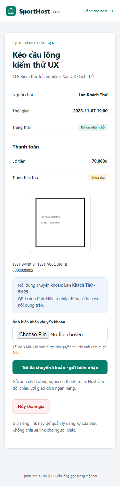

Nguồn đối chiếu: `app/templates/participant.html:8` đọc thông tin hiện tại của CLB, còn route QR trong `app/payments.py` ưu tiên `booking.qr_key`. `due_payment.html` có cùng cấu trúc; cần kiểm tra và sửa đồng thời, dù kịch bản live ở đây tái hiện trên booking.

**Tiêu chí sửa:** ngân hàng, tên chủ tài khoản, số tài khoản, QR và hướng dẫn chuyển tiền của một khoản thu luôn cùng phiên bản. Thay ngân hàng phải có hành vi rõ ràng cho khoản đang chờ.

### UX-02 — Mất đường quay lại booking khi đổi trình duyệt

1. Khách A đăng ký bằng trình duyệt thứ nhất và mở được trang riêng.
2. Mở link tuyển khách trong context mới, không có cookie cũ.
3. Nhập lại đúng số điện thoại và xác nhận.
4. Chỉ nhận “Số điện thoại này đã đăng ký… Hãy liên hệ host”; **không có link theo dõi hoặc nút liên hệ host**.

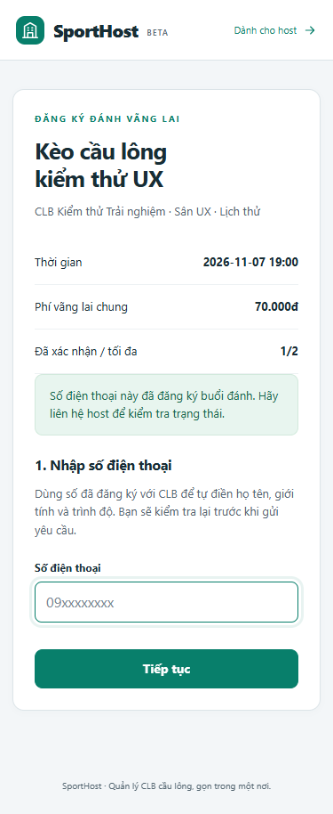

Nguồn đối chiếu: `app/main.py:607`, link riêng được nhận diện bằng cookie gắn với trình duyệt. Tình huống thực tế thường gặp khi chuyển từ trình duyệt trong Zalo/Facebook sang Chrome hoặc đổi máy.

**Tiêu chí sửa:** khách có hướng dẫn lưu link sau đăng ký và cách khôi phục được xác thực. Không trả link riêng chỉ dựa vào số điện thoại nhập vào; nên dùng OTP/magic link hoặc quy trình cấp lại bởi host có xác minh.

### UX-03 — Trạng thái khách không theo kịp thao tác host

Giữ trang khách ở “Chờ host duyệt”, duyệt từ trình duyệt host, rồi quay lại trang khách đang mở. Trang vẫn giữ trạng thái cũ; chỉ sau reload mới xuất hiện chỗ đã xác nhận và thanh toán. Không có nút cập nhật trạng thái trong màn hình.

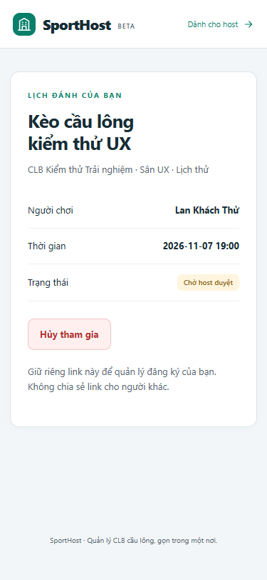

**Tiêu chí sửa:** có nút làm mới dễ thấy và cập nhật trạng thái khi quay lại trang; nếu dùng polling, thông báo lần cập nhật gần nhất và lỗi mất kết nối. Xác nhận chỗ và chờ đối chiếu biên nhận cần có hướng dẫn tiếp theo, không phụ thuộc người dùng tự đoán phải reload.

### UX-04 — Khôi phục mật khẩu là ngõ cụt trên bản đang chạy

Từ Đăng nhập → Quên mật khẩu → nhập email → Gửi hướng dẫn: trang báo 503 “Email khôi phục đang được cấu hình; liên hệ quản trị…”. Không có kênh hỗ trợ trực tiếp trên trang.

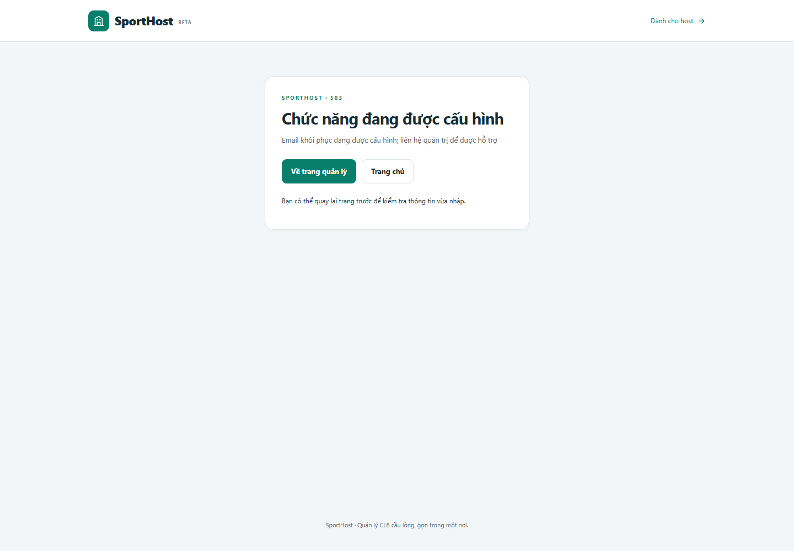

Đây là thiếu cấu hình dịch vụ đã biết, nhưng vẫn là gap đối với host bình thường: người quên mật khẩu chưa tự lấy lại tài khoản được. `app/accounts.py:115` xác nhận hành vi này.

**Tiêu chí sửa:** kiểm tra nhận thư thực tế, token dùng một lần/hết hạn. Khi dịch vụ chưa sẵn sàng, báo rõ trước khi yêu cầu người dùng nhập email, kèm phương án hỗ trợ được vận hành.

### UX-05 — Lỗi form làm đứt luồng nhập

Trong form thêm thành viên, nhập số `09000000` rồi lưu: trang chuyển sang lỗi 400, chỉ ghi **Invalid phone** và hai nút điều hướng chung; sidebar và form không còn ở màn hình này. Người dùng phải dùng Back mới sửa được. Không khẳng định mọi trình duyệt làm mất dữ liệu: lần thử này Back còn giữ một phần dữ liệu do trình duyệt phục hồi.

Đăng nhập sai mật khẩu cũng làm trường email trở về trống; đã kiểm tra giá trị input sau lỗi.

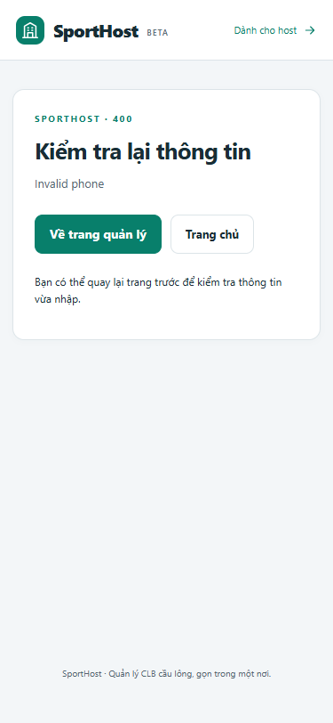

**Tiêu chí sửa:** lỗi tiếng Việt ngay dưới trường, `aria-describedby`, giữ email/các trường không nhạy cảm và đưa focus tới lỗi. Không giữ hoặc phản hồi lại mật khẩu.

### UX-06 — Bảng mobile chia cắt danh tính và hành động

Ở 375px, vùng cuộn bảng người chơi rộng **341px** nhưng nội dung rộng **643px**. Khi kéo sang cột Duyệt/Thêm, tên và số điện thoại đi ra ngoài khung. Host cần kéo qua lại để chắc đang thao tác đúng người.

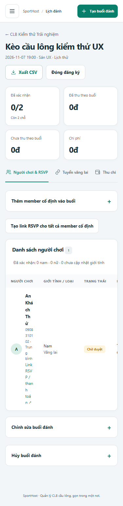
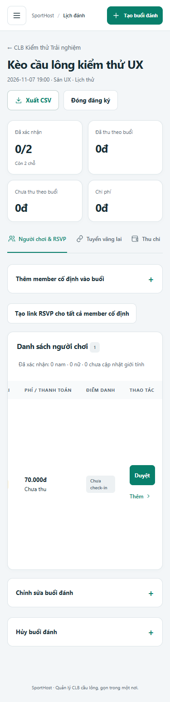

Đây là vấn đề khả dụng trong bảng, không phải toàn trang bị tràn ngang. Cuộn ngang là phương án web hợp lệ theo skill; với nghiệp vụ duyệt/thu tiền thường xuyên, card mobile hoặc cột danh tính cố định sẽ phù hợp hơn.

### UX-07 — Tạo phí xong mất tab và không thấy kết quả

Vào CLB → Phí tháng → chọn member, kỳ `2026-11`, số tiền → Tạo/sửa. Request thành công nhưng URL trở về `/clubs/{id}`, tab Tổng quan mở và không có thông báo đã lưu. Phải mở Phí tháng lần nữa mới thấy khoản thu.

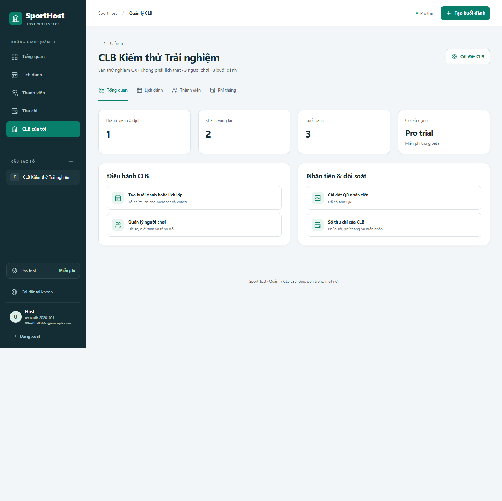

Nguồn đối chiếu: `app/main.py:503`. **Tiêu chí sửa:** trở về `#monthly`, thông báo rõ tạo mới/cập nhật, làm nổi bật khoản vừa lưu và giữ bộ lọc khi phù hợp.

### UX-08 — “Mở đăng ký” chưa phản ánh hạn RSVP

Tạo lịch hai tuần với hạn RSVP 24 giờ. Danh sách host ghi **Mở đăng ký**; mở link tuyển khách cùng lúc thì báo phải chờ tới hạn mở vãng lai.

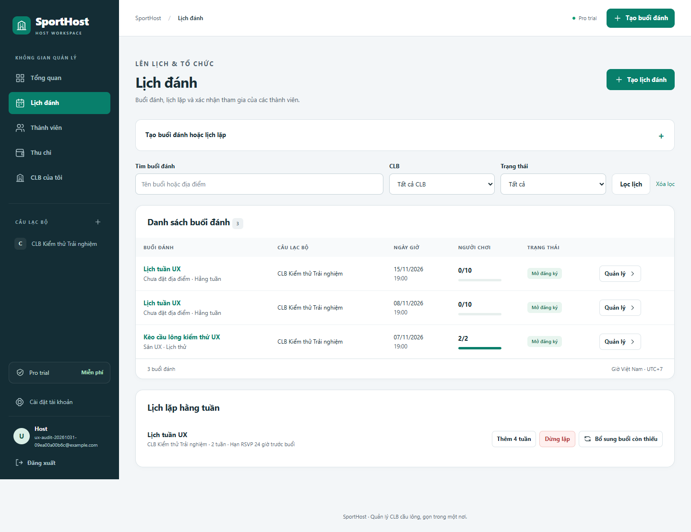
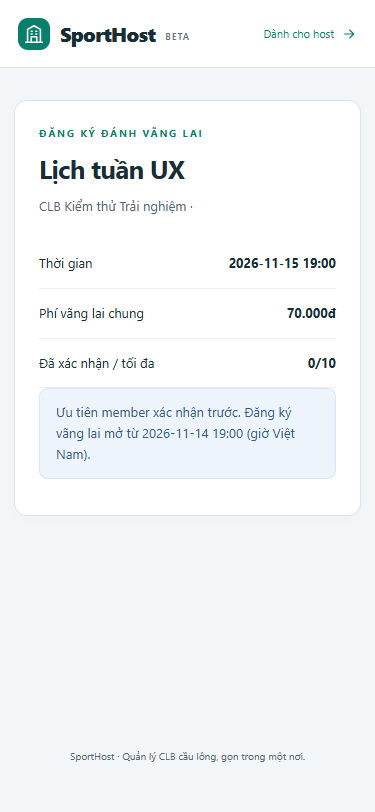

**Tiêu chí sửa:** trạng thái “Ưu tiên member”, “Nhận vãng lai từ …”, “Đang nhận vãng lai”, “Đã đóng/đã hủy” nhất quán giữa các màn hình; nút mở/đóng phải phân biệt việc cho phép nhận khách với thời điểm thực sự bắt đầu nhận.

### UX-09 — Chia sẻ RSVP riêng còn nhiều bước

Lịch tuần tạo được lời mời cho member, và member xác nhận/hủy thành công. Nhưng trong bảng host, link riêng chỉ là liên kết mở tab mới. Không có nút Copy cho từng member; kiểm tra DOM vùng người chơi ghi nhận **0** nút copy. Link tuyển khách chung có Copy, nên cách thao tác chưa nhất quán.

**Tiêu chí sửa:** Copy/Chia sẻ cạnh đúng người, thông báo đã sao chép, ghi rõ đây là link riêng. Trên mobile có thể dùng Web Share với fallback copy; không chia sẻ hàng loạt các link riêng cho cả nhóm.

### UX-10 — Không có trạng thái đang lưu

Giữ request lưu mức phí ở trình duyệt để mô phỏng mạng chậm: nút vẫn ghi **Lưu mức phí**, `disabled=false`. Người dùng chưa phân biệt được chưa gửi hay đang xử lý và có thể nhấn lặp.

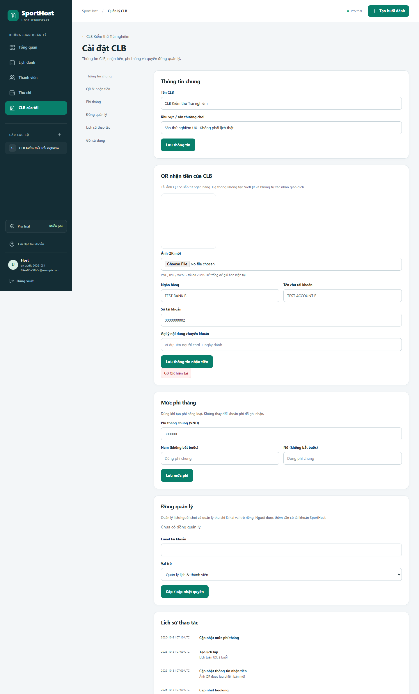

**Tiêu chí sửa:** phản hồi ngay “Đang lưu…”, hạn chế submit lặp, phục hồi nút khi lỗi và báo thành công sau khi lưu. Audit này **không kết luận đã tạo dữ liệu trùng**; bằng chứng là thiếu phản hồi và chặn thao tác lặp tại UI.

### UX-11 — Accessibility cần hoàn thiện

- Axe phát hiện `aria-allowed-attr`: 3 link tab ở buổi đánh và 4 link tab ở CLB có `aria-selected` trên phần tử mang role link. `public/static/workspace.js:36` gán thuộc tính này. Chọn ngữ nghĩa tab đầy đủ cùng tương tác bàn phím tương ứng, hoặc giữ điều hướng link và dùng trạng thái phù hợp.
- Axe phát hiện `link-in-text-block` ở link **Tạo tài khoản** trong trang đăng nhập: màu link so với đoạn bao quanh có tỷ lệ **1,22:1**, không có dấu hiệu thường trực như gạch chân. Đây là tỷ lệ phân biệt link với văn bản xung quanh, không phải tỷ lệ chữ với nền.
- Vài summary/nút Thêm trên mobile cao **32px**. Nên mở rộng vùng chạm theo hướng dẫn 44px của skill. Không coi riêng số đo này là chứng minh vi phạm yêu cầu tối thiểu 24px của WCAG 2.2.

Tổng tự động: **2 nhóm rule, 8 node bị đánh dấu trên 3/6 màn hình**. Mức ưu tiên sản phẩm ở đây là P2; nhãn severity của axe không tự động tương đương P0/P1.

### UX-12 — Nội dung và thời gian

Trang auth ghi “SPORTSHOST WORKSPACE” thay vì SportHost. Trang biên nhận hiển thị timestamp dạng `2026-10-31T07:08 UTC`, trong khi lịch đánh dùng giờ Việt Nam. Các nhãn “member”, “slot”, “check-in” và tiếng Việt trộn nhiều cách.

**Tiêu chí sửa:** thống nhất SportHost; ưu tiên “31/10/2026, 14:08” theo giờ Việt Nam, vẫn lưu UTC ở backend; thống nhất bộ từ ngữ theo nhóm người dùng.

## Thứ tự xử lý đề xuất

1. **Thông tin tiền:** sửa phiên bản nhận tiền; kiểm tra cả phí buổi và phí tháng.
2. **Theo dõi đăng ký:** lưu/khôi phục link riêng an toàn, cập nhật trạng thái và cách liên hệ host.
3. **Khôi phục tài khoản:** cấu hình email thực tế và hoàn thiện thông báo chưa sẵn sàng.
4. **Luồng thao tác:** lỗi tại form, giữ tab/bộ lọc, trạng thái đang lưu và xác nhận kết quả.
5. **Host dùng điện thoại:** card người chơi/thao tác, copy RSVP, trạng thái tuyển khách, accessibility và copy.

## Phạm vi kết luận

Đây là kiểm thử trải nghiệm có hướng dẫn bằng các nhiệm vụ thực tế, chưa phải nghiên cứu usability với nhiều host ngoài đời. Chưa kiểm thử thiết bị vật lý, screen reader thủ công, chất lượng camera quét QR ngân hàng thật, tải đồng thời lớn hoặc email thật. Các ảnh chỉ chứa dữ liệu thử nghiệm. Không dùng bộ test chức năng cũ làm bằng chứng thay thế trải nghiệm live lần này.
